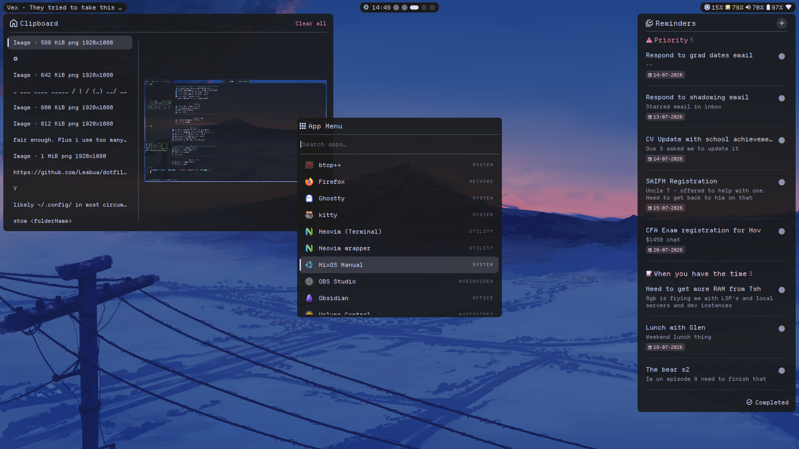
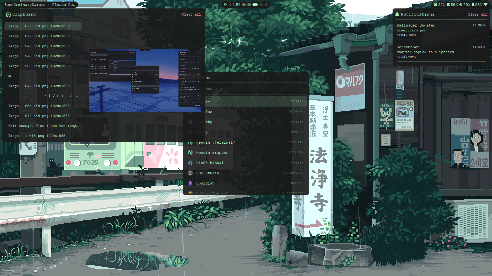
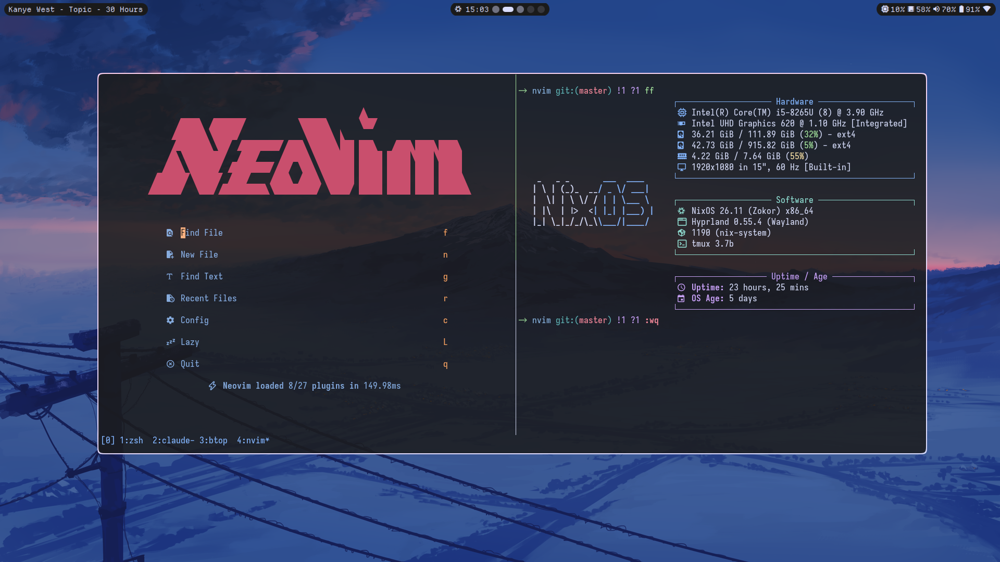

# Lea’s dotfiles

My desktop setup for NixOS and Arch: Hyprland, Quickshell, Ghostty, Bash, and Neovim. Herdr handles most terminal sessions; tmux stays available as an alternative. Niri is included as an alternative compositor.

These are personal configs, currently maintained on NixOS. Start with an installed system, networking, Git, and GNU Stow. Review the host settings and paths before applying them to another machine.



<details>
<summary>More screenshots</summary>





</details>

## Install on NixOS

The system configuration lives in [`nixos/`](nixos). Rebuild directly from the repository; this directory is not a Stow package.

1. Clone the repository:

   ```sh
   git clone https://github.com/Leabua/dotfiles.git ~/dotfiles
   cd ~/dotfiles
   ```

2. Enable flakes if needed. Add this to your existing NixOS configuration and rebuild it once:

   ```nix
   nix.settings.experimental-features = [ "nix-command" "flakes" ];
   ```

3. Replace the hardware configuration with the one generated for your machine:

   ```sh
   cp /etc/nixos/hardware-configuration.nix ~/dotfiles/nixos/
   ```

   Review [`configuration.nix`](nixos/configuration.nix), especially the username, hostname, and `/mnt/hdd` mount. The flake output is named `nixos`.

4. Link the desktop configs you want, then rebuild:

   ```sh
   stow bash starship ghostty herdr hypr quickshell matugen wallpapers nvim btop fastfetch gtk satty
   sudo nixos-rebuild switch --flake ~/dotfiles/nixos#nixos
   ```

5. Log out and back in to start a session with Bash as the login shell. Existing terminal panes keep running their current shell.

Add applications to [`nixos/packages.nix`](nixos/packages.nix) and development tools to [`nixos/dev.nix`](nixos/dev.nix). The [NixOS notes](nixos/README.md) cover the other modules and maintenance commands.

## Install on Arch

Follow [`arch.md`](arch.md) for packages, services, and system settings, then use Stow as below. Some desktop configs contain NixOS paths and may need adjusting on Arch.

## Manage configs with Stow

Run Stow from `~/dotfiles`. It creates links in your home directory, so edits through either the repository or the linked path update the same file.

```sh
cd ~/dotfiles
stow ghostty herdr nvim       # link selected packages
stow --simulate --verbose bash starship  # preview changes
stow -D zsh                  # remove links, keeping the repo files
```

Back up conflicting files before stowing a package. Choose packages individually: `nixos`, `scripts`, and `assets` are not Stow packages.

Most packages link into `~/.config`. Bash links `.bashrc` and `.bash_profile` into `~`, Starship links `~/.config/starship.toml`, and wallpapers links `~/Wallpapers`.

Quickshell supplies the bar, launcher, notifications, clipboard, and power menu. The older `waybar`, `rofi`, `walker`, and `mako` configs are available for an alternative setup; choose which components to start in your compositor’s autostart config. Stowing a config alone does not start its application.

## Bash and Starship

Bash replaces Zsh as the default shell. The original [`zsh/`](zsh) configuration is kept for reference, with its NixOS settings commented out.

To migrate an existing checkout:

```sh
cd ~/dotfiles
stow -D zsh
stow bash starship
sudo nixos-rebuild switch --flake ~/dotfiles/nixos#nixos
```

Starship keeps a single line with `->`, the current directory, and `git:(branch)` plus Git changes and ahead/behind counts. It uses the original prompt’s colours without blank lines or a right prompt. Bash uses native Readline editing, and FZF supplies fuzzy search.

Starship truncates long branches at the end and uses its own Git counters and directory shortening. Language, cloud, and environment segments from the old p10k config are omitted.

The [Bash settings](bash/.bashrc) keep input plain, with ordinary Tab completion and FZF history search on `Ctrl+R`. `Ctrl+U` deletes back to the start of the line, and `Ctrl+K` deletes to the end. Inline suggestions and syntax colouring are not enabled. Run `exec bash -l` to reload the setup in an existing pane.

NixOS loads FZF's native Bash integration; `.bashrc` provides a fallback for Arch. The [prompt hook](bash/.config/bash/prompt.sh) renders Starship once per command, without command timers, job counting, or an empty right prompt. Ghostty's shell integration runs without prompt-marker patches.

Ghostty explicitly starts Bash, Herdr opens Bash in new panes, and tmux selects the Bash path for NixOS or Arch. Keep both configs stowed if you still use both tools. After editing Herdr’s config, `herdr server reload-config` applies it to new panes without closing existing sessions.

The Bash config preserves these NixOS shortcuts:

| Command | Action |
| --- | --- |
| `nixconf` | Open the system configuration in Neovim |
| `rebuild` | Apply the flake with nix-output-monitor |
| `upgrade` | Update flake inputs, then rebuild |
| `clean` | Delete old generations and garbage collect, then update the boot configuration |

## Packages

| Package | Purpose |
| --- | --- |
| [`bash`](bash) | Shell startup, aliases, history search, and standard Bash editing |
| [`starship`](starship) | Prompt adapted from the p10k configuration |
| [`ghostty`](ghostty) | Daily terminal emulator |
| [`herdr`](herdr) | Daily terminal multiplexer with Neovim-aware pane navigation |
| [`tmux`](tmux) | Alternative terminal multiplexer |
| [`hypr`](hypr) | Hyprland, bindings, window rules, locking, and idle settings |
| [`niri`](niri) | Alternative compositor with scrollable tiling |
| [`quickshell`](quickshell) | Custom `minimalBar` desktop shell and menus |
| [`matugen`](matugen) | Wallpaper-derived colours for the desktop |
| [`wallpapers`](wallpapers) | Wallpaper collection used by the rotation script |
| [`nvim`](nvim) | Neovim plugins, LSP, keymaps, and colours |
| [`btop`](btop) | Resource monitor |
| [`fastfetch`](fastfetch) | System information display |
| [`gtk`](gtk) | GTK 3 and GTK 4 appearance settings |
| [`satty`](satty) | Screenshot annotation |
| [`alacritty`](alacritty) | Alternative terminal emulator |
| [`bluetui`](bluetui) | Bluetooth TUI |
| [`impala`](impala) | Wi-Fi TUI for iwd |
| [`wiremix`](wiremix) | PipeWire audio TUI |
| [`yazi`](yazi) | Terminal file manager |
| [`pacseek`](pacseek) | Arch package browser |
| [`mako`](mako) | Alternative notification daemon |
| [`rofi`](rofi) | Alternative launcher and menus |
| [`walker`](walker) | Alternative application launcher |
| [`waybar`](waybar) | Alternative status bar |
| [`zed`](zed) | Zed editor settings and keymaps |
| [`zsh`](zsh) | Previous shell and p10k prompt, retained for reference |

[`scripts/`](scripts) contains helpers that run directly from the repository. Bash adds it to `PATH`; desktop configs also refer to `~/dotfiles/scripts`. [`assets/`](assets) holds the README screenshots.
