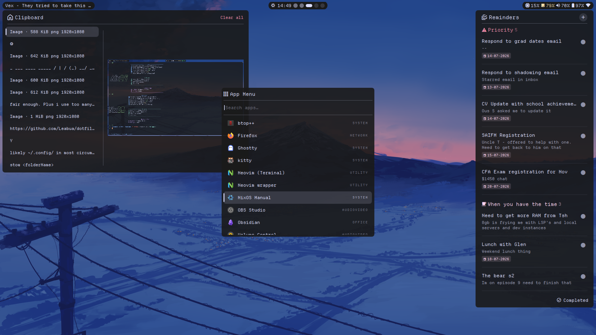

# dotfiles

Hyprland, Quickshell, Ghostty, zsh, Neovim. Arch first, NixOS still supported.



## Arch

See [`arch.md`](arch.md), then:

```sh
git clone https://github.com/Leabua/dotfiles.git ~/dotfiles
cd ~/dotfiles
stow zsh ghostty herdr hypr quickshell matugen wallpapers nvim
```

## NixOS

```sh
cp /etc/nixos/hardware-configuration.nix ~/dotfiles/nixos/
sudo nixos-rebuild switch --flake ~/dotfiles/nixos#nixos
```

Check the username, hostname, and mounts in [`configuration.nix`](nixos/configuration.nix) first. More in [`nixos/README.md`](nixos/README.md).

## Packages

Stow packages: `alacritty` `bash` `btop` `fastfetch` `ghostty` `herdr` `hypr` `matugen` `niri` `nvim` `quickshell` `satty` `tmux` `wallpapers` `zed` `zsh`

Not stowed: `nixos`, `scripts` (on `PATH` via zsh), `assets`.
