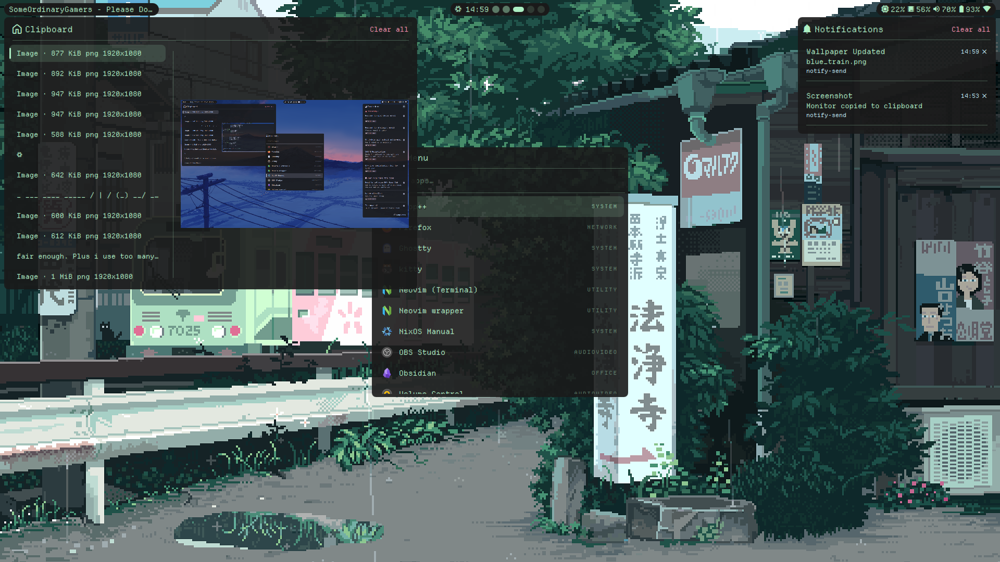
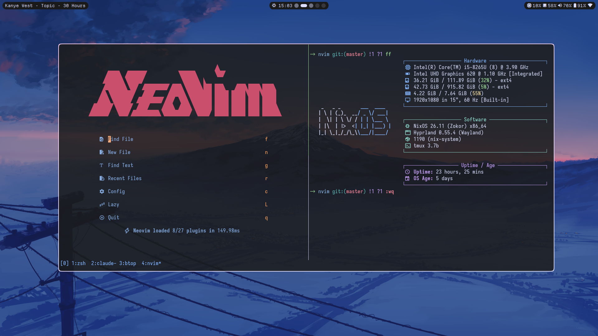

# Lea’s dotfiles

My desktop setup for NixOS and Arch: Hyprland, Quickshell, Ghostty, zsh, and Neovim. Herdr handles most terminal sessions; tmux stays available as an alternative. Niri is included as an alternative compositor.

These are personal configs, currently maintained on NixOS. Start with an installed system, networking, Git, and GNU Stow. Review the host settings and paths before applying them to another machine.


<details>
<summary>More screenshots</summary>





</details>

## Install on NixOS

The system configuration lives in [`nixos/`](nixos). Rebuild directly from the repository; this directory is not a Stow package.

1. Clone the repository:

   ```sh
   git clone https://github.com/Leabua/dotfiles.git ~/dotfiles
   cd ~/dotfiles
   ```

2. Enable flakes if needed. Add this to your existing NixOS configuration and rebuild it once:

   ```nix
   nix.settings.experimental-features = [ "nix-command" "flakes" ];
   ```

3. Replace the hardware configuration with the one generated for your machine:

   ```sh
   cp /etc/nixos/hardware-configuration.nix ~/dotfiles/nixos/
   ```

   Review [`configuration.nix`](nixos/configuration.nix), especially the username, hostname, and `/mnt/hdd` mount. The flake output is named `nixos`.

4. Link the desktop configs you want, then rebuild:

   ```sh
   stow zsh ghostty herdr hypr quickshell matugen wallpapers nvim btop fastfetch gtk satty
   sudo nixos-rebuild switch --flake ~/dotfiles/nixos#nixos
   ```

5. Log out and back in to start a session with zsh as the login shell. Existing terminal panes keep running their current shell.

Add applications to [`nixos/packages.nix`](nixos/packages.nix) and development tools to [`nixos/dev.nix`](nixos/dev.nix). The [NixOS notes](nixos/README.md) cover the other modules and maintenance commands.

## Install on Arch

Follow [`arch.md`](arch.md) for packages, services, and system settings, then use Stow as below. Some desktop configs contain NixOS paths and may need adjusting on Arch.

## Manage configs with Stow

Run Stow from `~/dotfiles`. It creates links in your home directory, so edits through either the repository or the linked path update the same file.

```sh
cd ~/dotfiles
stow ghostty herdr nvim       # link selected packages
stow --simulate --verbose zsh  # preview changes
stow -D zsh                  # remove links, keeping the repo files
```

Back up conflicting files before stowing a package. Choose packages individually: `nixos`, `scripts`, and `assets` are not Stow packages.

Most packages link into `~/.config`. zsh links `.zshrc` and `.p10k.zsh` into `~`, and wallpapers links `~/Wallpapers`.

Quickshell supplies the bar, launcher, notifications, clipboard, and power menu. The older `waybar`, `rofi`, `walker`, and `mako` configs are available for an alternative setup; choose which components to start in your compositor’s autostart config. Stowing a config alone does not start its application.

## Thunar appearance

The `gtk` package styles Thunar in minimalBar's language: one charcoal plane, white
text, and the wallpaper accent for icons, hover and selection washes, and the path
bar island. Matugen writes the accent to `gtk-3.0/quickshell-colors.css`. Its post hook
runs [`scripts/quickshell-icons`](scripts/quickshell-icons), which redraws the
`Quickshell` icon theme in `~/.local/share/icons`: line icons for files, folders,
drives and the toolbar, drawn like `MenuIcon.qml`. App icons still come from Papirus Dark.

Run `matugen image /path/to/wallpaper` once after stowing `gtk` and `matugen`; wallpaper
rotation keeps it current. NixOS supplies the rest: xfconf (Thunar's settings), tumbler
(thumbnails), and a one-line Thunar patch that removes the sidebar's built-in indent.

### File preview

Ctrl+Space in Thunar opens the selected file in a minimalBar card
([`menus/preview`](quickshell/.config/quickshell/minimalBar/menus/preview)): video and
audio play with full transport controls, PDFs render page by page, and images, text and
folders show inline. It's a Thunar custom action (Edit → Configure custom actions) running
`qs -p ~/.config/quickshell/minimalBar ipc call preview toggle <path>`.

| Key | Action |
| --- | --- |
| Space | Play or pause, or next page in a PDF |
| ← → | Seek 5 s, or turn the page |
| ↑ ↓ | Volume |
| M | Mute |
| Return | Open in its app |
| Esc | Close |

NixOS wraps Quickshell with QtMultimedia and the extra image formats, and installs
poppler-utils for PDFs.

## zsh and Powerlevel10k

zsh is the login shell, with the [Powerlevel10k prompt](zsh/.p10k.zsh): one line with `->`, the directory, and `git:(branch)` plus changes. [`.zshrc`](zsh/.zshrc) adds grey history suggestions, syntax colouring, and Up/Down history search by prefix. Editing uses Emacs keys like Bash: `Ctrl+U` deletes to the start of the line, `Ctrl+K` to the end, and FZF searches history on `Ctrl+R`. Unmatched globs stay literal (`no_nomatch`), so commands written for Bash behave the same.

NixOS installs the plugins and links them into `/run/current-system/sw/share`; `.zshrc` also checks the Arch paths. Ghostty starts zsh, Herdr opens zsh in new panes, and tmux selects the zsh path for NixOS or Arch. After editing Herdr's config, `herdr server reload-config` applies it to new panes.

The unused [`bash/`](bash) and [`starship/`](starship) packages are kept for switching back.

## Packages

| Package | Purpose |
| --- | --- |
| [`zsh`](zsh) | Login shell, Powerlevel10k prompt, suggestions, and syntax colouring |
| [`bash`](bash) | Previous shell setup, kept for switching back |
| [`starship`](starship) | Previous Bash prompt, adapted from the p10k configuration |
| [`ghostty`](ghostty) | Daily terminal emulator |
| [`herdr`](herdr) | Daily terminal multiplexer with Neovim-aware pane navigation |
| [`tmux`](tmux) | Alternative terminal multiplexer |
| [`hypr`](hypr) | Hyprland, bindings, window rules, locking, and idle settings |
| [`niri`](niri) | Alternative compositor with scrollable tiling |
| [`quickshell`](quickshell) | Custom `minimalBar` desktop shell and menus |
| [`matugen`](matugen) | Wallpaper-derived colours for the desktop |
| [`wallpapers`](wallpapers) | Wallpaper collection used by the rotation script |
| [`nvim`](nvim) | Neovim plugins, LSP, keymaps, and colours |
| [`btop`](btop) | Resource monitor |
| [`fastfetch`](fastfetch) | System information display |
| [`gtk`](gtk) | GTK 3 and GTK 4 appearance settings |
| [`satty`](satty) | Screenshot annotation |
| [`alacritty`](alacritty) | Alternative terminal emulator |
| [`bluetui`](bluetui) | Bluetooth TUI |
| [`impala`](impala) | Wi-Fi TUI for iwd |
| [`wiremix`](wiremix) | PipeWire audio TUI |
| [`yazi`](yazi) | Terminal file manager |
| [`pacseek`](pacseek) | Arch package browser |
| [`mako`](mako) | Alternative notification daemon |
| [`rofi`](rofi) | Alternative launcher and menus |
| [`walker`](walker) | Alternative application launcher |
| [`waybar`](waybar) | Alternative status bar |
| [`zed`](zed) | Zed editor settings and keymaps |
| [`zsh`](zsh) | Previous shell and p10k prompt, retained for reference |

[`scripts/`](scripts) contains helpers that run directly from the repository. zsh adds it to `PATH`; desktop configs also refer to `~/dotfiles/scripts`. [`assets/`](assets) holds the README screenshots.
